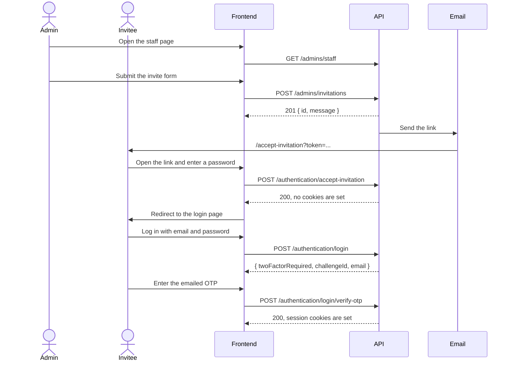

# Staff invitations: frontend guide

This guide tells the frontend which pages to build and which endpoints to call for staff invitations. A DOED Admin invites an Evaluator or a Provincial Officer by email. The account exists only after the invited person opens the link and sets a password.

All paths are under `/twhp/api`. The API uses session cookies, so send every authenticated request with `credentials: "include"`. The full schema is in `docs/api/openapi.json`.

## The flow



## Pages to build

| Page | Who can open it | Purpose |
|---|---|---|
| Staff list | DOED only | Show staff and pending invitations, and start every Admin action |
| Invite form, as a page or a modal | DOED only | Create an invitation for either role |
| Correct email dialog | DOED only | Change the email of an unaccepted invitation |
| Cancel confirmation dialog | DOED only | Confirm before the invitation is deleted |
| Accept invitation, at `/accept-invitation` | Public | Let the invited person set a password |

The invited person uses the existing login and OTP pages. No new login page is needed.

The email links to `${FRONTEND_URL}/accept-invitation?token=<token>`. The page must exist at that path. If the frontend needs a different path, tell the backend team, because the path is set in `src/worker/email.ts`.

## Admin: list staff

Call `GET /admins/staff` when the staff page opens, and again after every successful invite, resend, correction, or cancel.

The response is a plain array with no pagination, so search and filter on the client. Invitations come first, ordered by `invitationId`, and accounts follow, ordered by `accountId`. Use `status` to tell the entry types apart.

A pending invitation:

```json
{
  "status": "pending",
  "invitationId": 1,
  "role": "Evaluator",
  "firstName": "Eval",
  "lastName": "New",
  "email": "eval-new@example.go.th",
  "phoneNumber": "0800000001",
  "level": "ODPC",
  "region": 13,
  "provinceId": null,
  "provinceName": null
}
```

An accepted account:

```json
{
  "status": "accepted",
  "accountId": 119,
  "username": "prov-new@example.go.th",
  "role": "Provincial",
  "firstName": "Prov",
  "lastName": "New",
  "email": "prov-new@example.go.th",
  "phoneNumber": "0800000002",
  "level": null,
  "region": null,
  "provinceId": 10,
  "provinceName": "กรุงเทพมหานคร"
}
```

Show these actions for each status:

| `status` | Meaning | Resend | Correct email | Cancel |
|---|---|---|---|---|
| `pending` | The link is live | Yes | Yes | Yes |
| `expired` | The link is older than 10 minutes | Yes | Yes | Yes |
| `accepted` | The account exists | No | No | No |

Use `invitationId` in every action URL. An accepted entry has no `invitationId`.

## Admin: invite someone

Call `POST /admins/invitations` when the Admin submits the form. Build the body for the selected role, and send only that role's fields.

Evaluator:

```json
{
  "role": "Evaluator",
  "email": "person@example.go.th",
  "firstName": "Somchai",
  "lastName": "Jaidee",
  "phoneNumber": "0812345678",
  "level": "ODPC",
  "region": 13
}
```

Provincial Officer:

```json
{
  "role": "Provincial",
  "email": "person@example.go.th",
  "firstName": "Somchai",
  "lastName": "Jaidee",
  "phoneNumber": "0812345678",
  "provinceId": 10
}
```

`level` is one of `Mental`, `DOH`, or `ODPC`. An Evaluator body that contains `provinceId` is refused, and a Provincial body that contains `level` or `region` is refused.

Fill the dropdowns from `GET /location/provinces`, which is public. It returns `[{ "name_th": "กระบี่", "province_id": 81, "health_region": 11 }]`. Use `province_id` for `provinceId`. Build the region list from the distinct `health_region` values.

| Status | Body | Show the Admin |
|---|---|---|
| 201 | `{ "id": 1, "message": "invitation sent" }` | Success, then reload the list |
| 400 | `{ "message": "email already exists" }` | This email already has an account |
| 400 | `{ "message": "email already invited" }` | This email has an unaccepted invitation |
| 400 | `{ "message": "health region not found" }` | Choose a valid region |
| 400 | `{ "message": "province not found" }` | Choose a valid province |

The API stores the email in lowercase, so the list can differ in letter case from what the Admin typed. The email comparison ignores letter case.

## Admin: manage an unaccepted invitation

| When | Request | Success | Effect |
|---|---|---|---|
| The person lost the email or the link expired | `POST /admins/invitations/:id/resend` | 200 `{ "message": "invitation resent" }` | Sends a new link with a new 10 minutes. The old link stops working. |
| The email address is wrong | `PATCH /admins/invitations/:id/email` with `{ "email": "new@example.go.th" }` | 200 `{ "message": "invitation email corrected" }` | Sends a new link to the new address. The old link stops working. |
| The Admin no longer wants to invite the person | `DELETE /admins/invitations/:id` | 200 `{ "message": "invitation cancelled" }` | Deletes the invitation and voids its link. The email can be invited again. |

The correction route also returns 400 with `email already exists` or `email already invited`.

All three routes return 404 `{ "message": "invitation not found" }` when the invitation is gone. This happens when another Admin cancelled it, or when the person accepted it while the page was open. On 404, reload the list.

Only the email can be corrected. To change a name, phone number, role, level, region, or province, cancel the invitation and send a new one.

## Invited person: accept the invitation

There is no endpoint that checks a token or returns invitation details. The page cannot know whether a link is valid before the person submits, and it cannot show the person's name or email.

1. Read `token` from the query string. If it is missing, show the invalid-link message and do not show the form.
2. Show a password field and a confirm-password field. Require at least 8 characters, and require that the two fields match. The API does not receive the confirm field.
3. Call `POST /authentication/accept-invitation` without a session:

   ```json
   { "token": "<token from the URL>", "password": "chosen-password" }
   ```

4. Handle the response:

| Status | Body | Do |
|---|---|---|
| 200 | `{ "message": "invitation accepted" }` | Show success and redirect to the login page. The response sets no cookies, so the person is not logged in. |
| 400 | `{ "message": "invalid token" }` | Show one message: the link is invalid or expired, so ask the Admin for a new one. |
| 400 | A validation body, as described in [Errors](#errors) | Show the password rule. The link is still usable. |

The API returns the same `invalid token` response for an unknown, expired, used, cancelled, or replaced link. The frontend cannot tell these cases apart, and it must not try.

## Invited person: first login

The username is the invited email in lowercase. Tell the person this on the success screen.

1. Call `POST /authentication/login` with `{ "username": "<email>", "password": "<password>" }`.
2. An invited account always needs OTP, including at its first login. The response is `{ "twoFactorRequired": true, "challengeId": "...", "email": "<masked email>" }`.
3. Call `POST /authentication/login/verify-otp` with `{ "challengeId": "...", "code": "<OTP>" }`. Success sets the session cookies.

Do not send an invited person to the seeded first-login password page. `GET /authentication` returns `change_pw: true` for an invited account from the start, and the first-login password routes refuse it with 400.

## Errors

| Status | Body | Do |
|---|---|---|
| 400, business rule | JSON `{ "message": "..." }`, as listed in each section | Show the mapped message |
| 400, validation | JSON such as `{ "message": "Expected union value", "on": "body", "property": "root", "summary": "..." }` | Treat it as a form or client bug. Validate on the client so that users do not see it. |
| 401 | The session is missing or expired | Send the user to the login page |
| 403 | Plain text `forbidden`, not JSON | The account is not DOED. Hide the Admin pages for other roles. |
| 404 | JSON `{ "message": "invitation not found" }` | Reload the staff list |

Read 403 as text. A call to `response.json()` on it throws an error.

## What the API does not provide

- An endpoint to validate a token or preview an invitation.
- Pagination or server-side search on `GET /admins/staff`.
- Editing or deactivating an accepted account.
- Inviting another Admin.
